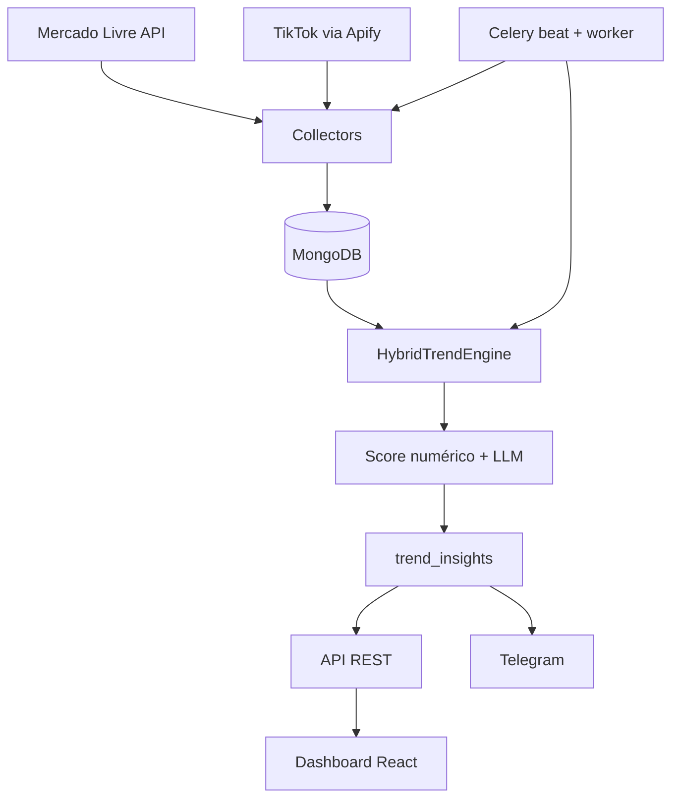

# 🚀 Trends Intelligence Engine

[](https://github.com/wrpaiva/bot-trends/actions/workflows/ci.yml)

> Motor híbrido de detecção de tendências: coleta Mercado Livre + TikTok, calcula um score
> matemático + LLM, expõe rankings via API REST e alerta no Telegram.

> ⚠️ **Estado atual (2026-09):** a API do Mercado Livre passou a exigir OAuth. O projeto já
> autentica (TIE-41), mas **a coleta do ML só funciona depois de criar o app no ML e autorizar
> uma vez** (ver "Autorizando o Mercado Livre"). A coleta do TikTok, a análise, a API, o
> dashboard e os alertas funcionam.

---

## 🏗️ Arquitetura



| Serviço (compose) | O que faz |
|---|---|
| `mongo` | Persistência (produtos, métricas, insights, categorias, estado dos alertas) |
| `redis` | Broker do Celery e contador do rate limit da API |
| `api` | FastAPI — rankings, busca, categorias (porta `API_HOST_PORT`, default 8000) |
| `worker` | Celery — consome as filas `celery`, `ml`, `tiktok` e `trend` |
| `beat` | Celery beat — agenda coleta e análise |
| `web` | Dashboard React servido por nginx (porta `WEB_HOST_PORT`, default 80) |
| `web-dev` | Dashboard em hot-reload, só com `--profile dev` (porta `WEB_DEV_HOST_PORT`, default 5173) |

### 📁 Estrutura

```
bot-trends/
├── backend/                 # Python 3.11 · FastAPI · Celery · MongoDB · Poetry
│   ├── apps/                # Entrypoints
│   │   ├── api/             # main.py (app, middlewares) · routes.py (endpoints)
│   │   ├── worker/          # main.py (Celery + beat) · tasks.py (coleta) · tasks_trend.py (análise) · tasks_link.py (vínculo TikTok → ML)
│   │   ├── migrate/         # Runner de migrações
│   │   └── bootstrap/       # Seed de categorias
│   └── src/                 # Core (Clean Architecture)
│       ├── domain/          # Entidades e regras puras (score, alertas) — sem I/O
│       ├── application/     # Casos de uso (HybridTrendEngine, prompt)
│       ├── infrastructure/  # Mongo, LLM, collectors, Telegram, config, segurança
│       └── tests/           # pytest
├── frontend/                # React 18 · Vite 5 · chart.js
├── docker-compose.yml
├── .env.example             # → .env da raiz (compose)
└── backend/.env.example     # → backend/.env (aplicação)
```

---

## 🚀 Subindo do zero

### 1️⃣ Os dois arquivos `.env`

São **dois** arquivos, com papéis diferentes:

| Arquivo | Lido por | Contém |
|---|---|---|
| `.env` (raiz) | `docker-compose.yml` | senhas do Mongo/Redis, `API_KEY`, `CORS_ORIGINS`, portas do host |
| `backend/.env` | serviços `api`, `worker`, `beat` | credenciais da aplicação: `LLM_*`, `APIFY_*`, `TIKTOK_*`, `TELEGRAM_*`, `ALERT_*`, `ML_*` |

```bash
cp .env.example .env
cp backend/.env.example backend/.env
openssl rand -hex 32        # use como API_KEY no .env da raiz
```

O compose **sobrescreve** `MONGO_URI`, `REDIS_URL`, `API_KEY` e `CORS_ORIGINS` do `backend/.env`
com valores montados a partir do `.env` da raiz. Sem `API_KEY` o compose se recusa a subir.

Variáveis que você provavelmente vai querer mexer:

| Variável | Arquivo | Para quê |
|---|---|---|
| `API_KEY` | raiz | Chave exigida no header `X-API-Key`. O nginx do dashboard a injeta no proxy `/api` em runtime — **não** vai para o bundle (TIE-27) |
| `CORS_ORIGINS` | raiz | Vazio por padrão: o dashboard usa a mesma origem. Só liste uma origem de browser que chame a API **direto** (na porta 80, `http://localhost`, **sem** `:80`) |
| `LLM_BASE_URL`, `LLM_API_KEY`, `LLM_MODEL` | backend | Qualquer gateway compatível com a API da OpenAI. Sem eles a análise usa só o score numérico |
| `APIFY_TOKEN`, `TIKTOK_HASHTAGS` | backend | Coleta do TikTok. **Custa crédito**: ~US$ 0,0037 por vídeo |
| `TIKTOK_RESULTS_PER_HASHTAG`, `TIKTOK_INTERVAL_MIN` | backend | Volume da coleta (default: 10 vídeos por hashtag a cada 120 min) |
| `TELEGRAM_BOT_TOKEN`, `TELEGRAM_CHAT_ID` | backend | Alertas. Sem eles a análise roda, só não alerta |
| `ALERT_THRESHOLD`, `ALERT_THRESHOLD_TIKTOK`, `ALERT_COOLDOWN_HOURS` | backend | Score mínimo para alertar (ML e fonte desconhecida / vídeo do TikTok) e intervalo entre alertas do mesmo produto |

A lista completa, com defaults, está em `backend/src/infrastructure/config.py`.

### 2️⃣ Subir

```bash
docker compose build && docker compose up -d     # produção
docker compose --profile dev up                  # + dashboard em hot-reload
```

Para atualizar, também `build` e depois `up -d`, não `up -d --build`: no Compose 2.37.1 (o do
Ubuntu 24.04), o `up -d --build` constrói a imagem nova e **deixa o container antigo rodando**
(visto em 2026-10-08). Na dúvida, compare `docker inspect -f '{{.Image}}' trends_api` com
`docker image inspect -f '{{.Id}}' bot-trends-api`.

A pasta `backups/` já vem no clone, com o seu usuário como dono. O serviço `backup` grava nela
como o uid `BACKUP_UID` (default 1000): se `id -u` não der 1000, ponha o seu em `BACKUP_UID` e
`BACKUP_GID` no `.env` da raiz. Apagou a pasta ou mudou `BACKUP_HOST_DIR`? Crie-a **antes** do
`up` — criada pelo Docker ela nasce `root`, e todo backup falha com `permission denied`.

Portas ocupadas por outro projeto? Troque `API_HOST_PORT`, `WEB_HOST_PORT`, `MONGO_HOST_PORT`,
`REDIS_HOST_PORT` e `WEB_DEV_HOST_PORT` no `.env` da raiz. Mongo e Redis só escutam em `127.0.0.1`.

### 3️⃣ Migrações, categorias e backfill (nesta ordem)

```bash
docker compose run --rm api python -m apps.migrate.main      # índices e collections
docker compose run --rm api python -m apps.bootstrap.main    # categorias padrão
```

Instalação nova termina aqui. **Só se você já tinha vídeos coletados** antes da data de
publicação existir (instalação antiga, com `APIFY_TOKEN`), preencha essa data a partir dos
datasets da Apify (só leitura, não gasta crédito) — sem ela esses vídeos ficam no cálculo antigo:

```bash
docker compose run --rm api python -m apps.backfill.tiktok_published --dry-run
docker compose run --rm api python -m apps.backfill.tiktok_published
```

**Autorizando o Mercado Livre.** A API do ML não é mais pública e só aceita OAuth com
autorização do usuário (não há client credentials). Uma vez:

1. Crie um app em [developers.mercadolivre.com.br](https://developers.mercadolivre.com.br/)
   com o escopo `offline_access` e cadastre uma redirect URI `https` (pode ser uma que nem
   carrega, ex.: `https://localhost/ml/callback`).
2. Preencha `ML_CLIENT_ID`, `ML_CLIENT_SECRET` e `ML_REDIRECT_URI` (idêntica à do app) no
   `backend/.env`.
3. Rode a autorização, abra a URL impressa, autorize e cole de volta a URL da barra de endereço:

```bash
docker compose run --rm -it api python -m apps.ml_auth.main    # --sem-pkce se o app não usar PKCE
docker compose run --rm api python -m apps.ml_auth.main --status
```

O par de tokens fica no Mongo (`ml_oauth`) e o worker o renova sozinho (o access token dura
6 h; o refresh token é de uso único e é regravado a cada renovação). Sem credenciais,
`collect_ml` devolve `status: error` com o motivo em `reason`; se o ML recusar o refresh token
(`invalid_grant`), a mensagem pede para rodar a autorização de novo.

O bootstrap é idempotente: rodar de novo atualiza nomes, mas não desabilita o que você
habilitou nem duplica categorias. Para buscar a árvore real do ML (exige a autorização acima):
`docker compose run --rm -e BOOTSTRAP_FETCH_ML_CATEGORIES=true api python -m apps.bootstrap.main`
(com `-e`: a variável no shell do host não chega ao container, e o bootstrap cairia no seed default).

**Escolhendo o que coletar.** Toda categoria nasce desabilitada — enquanto nada for habilitado,
`collect_ml` devolve `{"status": "no enabled categories"}`. Cada categoria habilitada custa
requisições a cada ciclo; comece com poucas, alinhadas ao nicho que você acompanha:

```bash
curl -H "X-API-Key: $API_KEY" "http://localhost:8000/categories?query=celular"
curl -X POST -H "X-API-Key: $API_KEY" -H "Content-Type: application/json" \
  -d '["MLB1051", "MLB1000"]' http://localhost:8000/categories/enable
```

Pelo dashboard, a aba **Categorias** faz o mesmo e cadastra subcategoria pelo ID do ML
(`MLB1618` = Cozinha): o nome vem do ML, e a categoria entra habilitada.

### 4️⃣ Conferir

```bash
curl http://localhost:8000/health                                   # {"status": "ok"}
curl http://localhost:8000/health/ready                             # mongo, redis e migrações
curl -H "X-API-Key: $API_KEY" http://localhost:8000/health/migrations
docker compose ps
```

No `docker compose ps`: a `api` fica `healthy` quando `/health/ready` não dá 503; o `worker`
responde a `celery inspect ping`; o `beat` não tem healthcheck (não serve HTTP nem ping).

O Docker Compose **não reinicia** container `unhealthy` — só o que termina. Por isso o
healthcheck da `api` (`apps/healthcheck/main.py`, TIE-38) distingue os dois casos:

| Falha | O que acontece |
|---|---|
| Readiness (`/health/ready` 503 — Mongo fora) | Só `unhealthy`. Reiniciar a API não conserta o Mongo; em loop, pioraria |
| Liveness (`/health` sem resposta) 3× seguidas (~90 s) | O healthcheck encerra a API (TERM, depois KILL); o container termina e o `restart: unless-stopped` o sobe de novo |

Para isso a `api` roda com `init: true`: dentro do container o PID 1 ignora SIGKILL vindo de
dentro, então a API tem de ser filha do init (tini). Nada recebe acesso ao `docker.sock`.

### 5️⃣ Da coleta ao ranking na tela

O beat coleta e analisa sozinho (ver "Agendamento"), mas a primeira coleta do ML só vem 6 h
depois da subida. Para ver o fluxo inteiro na hora, dispare as tasks pelo próprio worker:

```bash
# Coleta do ML nas categorias habilitadas → {'status': 'ok', 'inserted': N, 'errors': 0}
docker compose exec worker python -c "from apps.worker.main import celery_app as a; \
  print(a.send_task('tasks.collect_ml').get(timeout=300))"

# Análise (janela de 72 h, como o beat) → {'status': 'ok', 'processed': N, ...}
docker compose exec worker python -c "from apps.worker.main import celery_app as a; \
  print(a.send_task('tasks.hybrid_trend_analyze').get(timeout=540))"

curl -H "X-API-Key: $API_KEY" "http://localhost:8000/rankings/latest?limit=5"   # count > 0
```

E então o dashboard (`http://localhost`, porta `WEB_HOST_PORT`) mostra o ranking. **Sem a
autorização do ML** a coleta devolve `{'status': 'error', ..., 'reason': 'faltam ML_CLIENT_ID,
ML_CLIENT_SECRET no backend/.env'}`, a análise `processed: 0` e o ranking fica vazio: é aqui que
a instalação nova para até o OAuth do passo 3 (conferido num Docker limpo em 2026-10-18, TIE-33). Validado de ponta
a ponta em 2026-10-08 (TIE-5): `MLB1051` + `MLB1000` habilitadas → 34 leituras, 0 erros → 33
produtos analisados → 33 no ranking e na tela. O que esperar hoje:

- **Só produtos do ML.** A coleta do TikTok depende de crédito na Apify; sem ele, o breaker
  `apify` aparece aberto no `/health/ready`, e vídeos com métricas de mais de 72 h saem da janela.
- **Score do ML entre ~5 e ~75, poucos alertas** (limiar 62 no ML, 85 no TikTok — ver
  "Alertas"). O score do ML sai da posição no ranking e da subida nele (+ preço): o ML não dá
  vendas, avaliações nem visitas a token comum (TIE-51), e o `rank_momentum` só pontua quando o
  produto sobe no ranking.
- A análise do beat pode coincidir com a manual: o ranking mostra só o insight mais recente de
  cada produto, então não duplica.

---

### 6️⃣ Produção

Em VPS, com HTTPS (renovação automática) e login na frente do dashboard e do `/api`:
**[docs/DEPLOY.md](docs/DEPLOY.md)** — `docker-compose.prod.yml` (só o Caddy publicado no host)
+ `infra/caddy/Caddyfile`.

---

## 🎛️ API

Swagger em `http://localhost:8000/docs`.

### 🔐 Autenticação

Toda rota, exceto `/` e `/health`, exige o header `X-API-Key` com o valor de `API_KEY`.
Sem ele, ou com valor errado, a resposta é `401`.

```bash
export API_KEY=...   # o mesmo do .env da raiz
curl -H "X-API-Key: $API_KEY" "http://localhost:8000/rankings/latest?hours=72&limit=10"
```

Há rate limit global de 100 requisições/min por IP, e 30/min em `/rankings/latest` e `/search`
(os probes `/health*` ficam de fora). O contador fica no Redis; com o Redis fora ele passa para
a memória de cada processo e a readiness mostra `degraded`.

**O dashboard não conhece a chave (TIE-27).** O browser chama `/api/...` na mesma origem do
dashboard; o nginx do container `web` repassa para a API e põe a `X-API-Key`, lida do ambiente do
container na subida (`frontend/nginx/default.conf.template`). Em desenvolvimento, o proxy do Vite
faz o mesmo. O CI faz o build com uma chave-canário e falha se ela aparecer no `dist`.

> **Isso esconde a chave; não autentica quem acessa.** Quem alcança o dashboard usa a API pelo
> proxy — e todo acesso pelo proxy chega à API com o IP do nginx, então o rate limit por IP vira
> um contador só para o dashboard. Para uso local basta. **Antes de expor na internet**, ponha
> controle de acesso (basic auth, SSO, IP allowlist) no proxy com TLS da TIE-34 — basic auth sem
> TLS manda a senha em claro.

### 📍 Endpoints

| Rota | Auth | Descrição |
|---|---|---|
| `GET /` | — | Identificação do serviço |
| `GET /health` | — | Liveness: o processo responde. Não depende de Mongo nem Redis |
| `GET /health/ready` | — | Readiness: `ready`; `degraded` (200) com Redis fora ou migração pendente/falha; `unavailable` (503) com Mongo fora. Usado pelo healthcheck do Docker |
| `GET /health/migrations` | ✅ | Status das últimas migrações: `ok`, `degraded` (alguma falhou) ou `running` |
| `GET /metrics` | ✅ | Métricas no formato Prometheus: requisições e latência da API por rota, idade da última coleta/insight/backup, fallback do LLM, filas e circuitos (ver "Observabilidade") |
| `GET /rankings/latest` | ✅ | Ranking por `final_score`, um item por produto (o insight mais recente). Query: `source` (`all`\|`mercadolivre`\|`tiktok`), `limit` (1–200), `hours` (1–720, recência: gerados nas últimas N horas), `window_hours` (opcional: só insights calculados com essa janela), `category` (opcional: `ml_category_id` do produto; tira o TikTok, que não tem categoria), `with_offer` (opcional, `true`: só vídeo com onde comprar no ML, TIE-53), `cursor`. Paginado por cursor. Cada item traz `category_name` (null se a categoria não está cadastrada) e `ml_offer` (vídeo vinculado: produto do ML com `nome`, `link`, `link_tipo` — `produto` ou `busca` —, `preco`, `n_ofertas`; null sem vínculo) |
| `GET /insights/latest` | ✅ | Insights gerados nas últimas `hours` horas, do mais novo ao mais antigo. Query: `limit`, `hours`, `window_hours` (opcional), `cursor`. Paginado por cursor |
| `GET /search` | ✅ | Busca no título (stemming em português, ignora acento), por relevância, com o último score de cada produto. Query: `q` (2–100 caracteres), `page`, `limit` (1–50) |
| `GET /products/{product_id}/insight/latest` | ✅ | Último insight do produto (404 se não houver) |
| `GET /products/{product_id}/curve` | ✅ | Produto + métricas das últimas `hours` horas, em ordem cronológica |
| `GET /categories` | ✅ | Categorias com `ml_category_id`, por nome. Query: `query` (trecho do nome, sem regex), `enabled` (opcional), `limit` |
| `POST /categories` | ✅ | Corpo: `{"ml_category_id": "MLB1618", "enabled": true}`. Cadastra a categoria (ou subcategoria) com o nome e o caminho buscados no ML; já existente só atualiza o nome. 404 se o ML não a conhece, 503 sem token do ML |
| `POST /categories/enable` | ✅ | Corpo: lista de `ml_category_id`. Habilita para a coleta |
| `POST /categories/disable` | ✅ | Corpo: lista de `ml_category_id`. Desabilita |

**Paginação.** `/rankings/latest` e `/insights/latest` devolvem `has_more` e `next_cursor`; para a
próxima página, repita a chamada com os mesmos filtros e `cursor=<next_cursor>`. O cursor é
opaco — não o monte nem interprete; cursor inválido ou de outra rota dá `400`. `/search` pagina
por `page`.

Datas saem em ISO 8601 com offset explícito (`2026-09-27T12:00:00+00:00`), sempre em UTC.

---

## 🧠 Motor de análise

### Score numérico (0–100)

Sete componentes normalizados para 0–1 (`backend/src/domain/scoring.py`). Os pesos abaixo são
os defaults; calibre por `SCORE_W_*` no `backend/.env` (precisam somar 1.0 — senão o processo
não sobe). Cada insight grava os pesos usados em `score_weights`.

**Cada fonte só pontua o que tem (TIE-48).** Item do ML usa posição no ranking, `rank_momentum`,
`reviews_velocity` e estabilidade de preço; vídeo do TikTok usa aceleração, views/h e
engajamento/h. O resto sai do cálculo e os pesos que sobram são renormalizados para somar 1 —
com os defaults, no ML ranking + subida ficam com ~86% (reviews não medido), no TikTok
social/views/engajamento com 45/27/27%. Métrica que vale zero em **todo** o grupo do percentil é
"não medida" e também sai (antes o empate valia 0,5 para todos: 35 pontos iguais em cada produto
do ML, e o ranking saía ordenado pela oscilação da oferta mais barata). Cada insight grava em
`debug.numeric_components` as `dimensoes` usadas e os `pesos_efetivos`; dimensão de fora vale `null`.

| Componente | Peso | Normalização |
|---|---|---|
| posição no ranking (`SCORE_W_RANK_POSITION`) | 0,15 | posição atual no `/highlights` (top 20): 1º = 1, 20º = 0 |
| `rank_momentum` | 0,15 | subida no `/highlights` do ML entre a leitura mais antiga e a mais recente da janela, em escala log (20º → 1º = 1; parado, caindo ou sem ranking — TikTok — = 0) |
| `reviews_velocity` | 0,10 | avaliações novas por dia (`/reviews/item` do ML, mais antiga × mais recente da janela); percentil na categoria (ou 0–50/dia). Sem avaliação — TikTok, e o ML desde 2026-10 (`/reviews/item` dá 403 a token comum) — = 0 |
| aceleração (`social_velocity`) | 0,25 | quanto o ritmo entre as 2 últimas leituras supera o ritmo médio de vida; 0 com leitura única ou abaixo de 1.000 views |
| views por hora de vida | 0,15 | percentil na categoria (ou escala log até 100 mil/h no modo absoluto) |
| engajamento por hora de vida | 0,15 | percentil na categoria (ou escala log até 10 mil/h) |
| estabilidade de preço | 0,05 | `1 − price_volatility` (só ML; dado sem fonte e sem preço = 0,5) |

**Tendência é ritmo, não total.** Para vídeos com data de publicação, views e engajamento entram
como **ritmo por hora de vida** (piso de `TREND_MIN_AGE_HOURS`, 6 h, para vídeo de minutos não
explodir a métrica), e vídeo com mais de `TREND_MAX_AGE_DAYS` (30) dias **fica fora da análise** —
não é tendência. Antes o score usava o total acumulado e o topo era um vídeo de 4 anos com 96 mi de
views. Produtos sem data de publicação (Mercado Livre, vídeos antigos sem backfill) seguem no
cálculo por total. Cada insight grava os sinais usados em `signals`.

**Só conteúdo que vende (`TREND_REQUIRE_COMMERCIAL`).** Vídeo do TikTok sem sinal de venda fica
fora da análise: precisa ter produto do TikTok Shop ou, no texto, loja (Shopee, Shein, Amazon,
Mercado Livre...), "link na bio", "comenta QUERO", preço em R$, código de produto, "achadinho",
"comprei". Nos 501 vídeos reais, `hasTikTokShopProduct` sozinho perderia 79 dos 97 vídeos das
hashtags de compra (afiliado da Shopee manda para a bio), e o texto não casou nenhum dos 404
vídeos de `#fyp`. A task devolve `skipped_no_product` e cada insight grava em
`commercial_marker` o que o fez contar como produto. `false` volta a pontuar tudo.

**Normalização (`SCORE_NORMALIZATION`).** Com `percentile` (padrão), views, engajamento,
`social_velocity` e `reviews_velocity` viram o percentil do produto **dentro da própria
categoria** no ciclo de análise — 5 mil views é excepcional para capinha e medíocre para
celular. Categoria com menos de `SCORE_PERCENTILE_MIN_GROUP` (5) produtos usa o pool global do
ciclo; pool global menor que isso volta à normalização `absolute` (as faixas da tabela). Cada
insight grava a base usada em `debug.numeric_components.normalization`.

> `reviews_velocity` do ML é zero para todos desde 2026-10 (403 em `/reviews/item`), então cai como
> "não medido" e o score do ML sai da posição e da subida no ranking (+ preço).

### LLM

O LLM classifica em `ESTAVEL`, `SUBINDO`, `VIRALIZANDO`, `PICO_TEMPORARIO` ou `EM_QUEDA`, dá um
score de potencial (0–100) e um risco (`BAIXO`, `MEDIO`, `ALTO`). A resposta é validada: valor
fora do domínio é rejeitado, score fora da faixa é ajustado para 0–100.

**Prompt (`backend/src/application/prompt_builder.py`).** O LLM recebe os sinais do produto
(ritmo, aceleração, idade, nº de leituras, por que conta como produto) e a referência do grupo
(mediana e p90 de cada sinal, mais o percentil do produto) — **nunca o score numérico pronto**:
com ele no prompt, o modelo copiava a nota e o `llm_score` ficava a ±0,4 do numérico. Traz um
exemplo few-shot por classificação e fala com quem decide se aposta no produto, não com quem
postou o vídeo. Cada insight grava a versão do prompt em `prompt_version` (`null` no fallback).

**Item do Mercado Livre (prompt v5, TIE-42).** Produto de marketplace não tem vídeo: o prompt
manda `social` e `referencia` como `null` e, no lugar, a fonte, a posição no ranking de mais
vendidos agora e no início da janela, o `rank_momentum` e o nº de leituras, com exemplos de item
subindo, parado no topo, caindo e em leitura única. Na v4 ele recebia sinais sociais zerados e
respondia "sem tração social" em tudo. Com os produtos reais do ML (2026-10-08):

| | v4 (340 insights) | v5 (50 insights) |
|---|---|---|
| Valores distintos de `llm_score` | 2 (20 ou 40) | 6 (25 a 65) |
| Classificações | só `ESTAVEL` | `ESTAVEL` 48, `SUBINDO` 1, `EM_QUEDA` 1 |
| Análises que citam views/engajamento/tração | quase todas | 0 |

O `SUBINDO` é um carregador que foi de 11º a 7º; o `EM_QUEDA`, um fone que caiu de 13º para 15º.
Produto que está no ranking de duas categorias sai uma vez por coleta, com a categoria e a
posição do primeiro ranking na ordem de `ml_category_id`; a leitura grava a categoria.

**Cache.** A análise do LLM é reaproveitada enquanto as métricas de entrada do produto não
mudam, por até `LLM_CACHE_TTL_HOURS` (default 6; `0` desliga), no Redis. O score numérico é
sempre recalculado. Estimativa: sem cache, até 2.400 chamadas/dia a cada 50 produtos (48 análises/dia);
com cache, cada produto só chama o LLM quando o TikTok traz métricas novas (a cada
`TIKTOK_INTERVAL_MIN`, 120 min → ≤ 12/dia) ou o TTL vence (4/dia se parado) — **teto de ~600/dia,
−75%**. A taxa real sai no log `llm.cache` e no retorno da task (`llm_cache_hits`/`misses`).

### Avaliação do prompt (TIE-26)

`apps.prompt_eval` mede o prompt com dados reais; rode antes e depois de mexer nele.

```bash
# 1) CSV CEGO (sem a resposta do modelo) com os vídeos analisados pelas versões pedidas
docker compose run --rm -v "$PWD/avaliacao:/out" api python -m apps.prompt_eval.main exportar --saida /out/rotulos.csv
# 2) rotule: classificacao_humana (ESTAVEL, SUBINDO, VIRALIZANDO, PICO_TEMPORARIO, EM_QUEDA) e score_humano (0–100)
# 3) concordância de cada versão com você: acerto, kappa de Cohen, Spearman do score (LLM e numérico)
docker compose run --rm -v "$PWD/avaliacao:/out" api python -m apps.prompt_eval.main concordancia --rotulos /out/rotulos.csv
# 4) estabilidade por temperatura (CUSTA chamadas ao LLM; teto em --max-chamadas)
docker compose run --rm api python -m apps.prompt_eval.main estabilidade --temperaturas 0,0.2,0.7 --repeticoes 3
```

**Temperatura e formato revisados (2026-10-05, `gpt-4.1-mini`, prompt v4, 20 vídeos × 3 repetições):**

| Temperatura | Respostas válidas | Desvio do score entre repetições | Classificação igual entre repetições |
|---|---|---|---|
| 0 | 60/60 | ±1,3 | 98% |
| **0,2** (em uso) | 60/60 | ±1,3 | 98% |
| 0,7 | 60/60 | ±2,5 | 98% |

Fica 0,2: tão estável quanto 0, e 0,7 dobra a variação sem ganho. O formato (`json_object` +
schema) não falhou em 180 chamadas. Nem a 0 é determinística (±1,3). A pasta `avaliacao/` está no
`.gitignore`.

### Score final

```
final_score = SCORE_W_NUMERIC × score_numérico + SCORE_W_LLM × score_llm     (default 0.6 / 0.4)
```

Se o LLM falhar, não estiver configurado ou responder fora do formato, o `final_score` é só o
numérico, e a classificação sai do numérico com cortes **por fonte** (`FALLBACK_CORTES` em
`scoring.py`): ML ≥ 62 `SUBINDO`, ≥ 80 `VIRALIZANDO`; TikTok ≥ 85 e ≥ 92. Racional em "Alertas".

### Alertas

Alerta no Telegram quando `final_score` passa do limiar **da fonte**: `ALERT_THRESHOLD`
(default 62) para item do ML e fonte desconhecida, `ALERT_THRESHOLD_TIKTOK` (default 85) para
vídeo. O mesmo produto só realerta depois de `ALERT_COOLDOWN_HOURS` (default 24) — ou antes, se a
classificação subir de faixa (ex.: `SUBINDO` → `VIRALIZANDO`). Falha no envio não interrompe a
análise; o alerta é tentado de novo no próximo ciclo. Um `alert_threshold` passado à task vale
para todas as fontes (útil para testar o envio).

**Por que um limiar por fonte** (TIE-43, replay de 2026-10-13). Desde a TIE-48 cada fonte só
pontua as próprias dimensões, e as escalas ficaram diferentes. Reprocessando com o motor atual
todas as coletas reais, como a análise as veria em cada instante:

| Numérico | p50 | p90 | p95 | p99 |
|---|---|---|---|---|
| ML (23 coletas, 06–13/10, 1.249 itens) | 35 | 55 | 57 | 67 |
| TikTok (23 coletas, 24–25/09, 467 itens) | 50 | 78 | 88 | 97 |

O vídeo só pontua percentis dentro do grupo (social, views, engajamento), então a mediana fica
perto de 50; o item do ML depende da posição e da subida no ranking. Um limiar único de 62 daria
~20–30 alertas/dia de TikTok, e o fallback chamaria 1 em cada 3 vídeos de `SUBINDO`.

**ML: 62.** Combinando o numérico novo com o `llm_score` do prompt v5 gravado logo depois de cada
coleta (897 itens, 98 produtos, 4,8 dias) e o cooldown de 24 h:

| Limiar | Alertas/dia | O LLM chamou de `SUBINDO` |
|---|---|---|
| 60 | 4,3 | 42/45 |
| **62** | **3,1** | **29/30** |
| 65 | 1,4 | 14/14 |
| 70 | 1,0 | 9/9 |

62 é o ponto em que quase tudo que passa o LLM também vê subindo, com volume de ~3 por dia. O
LLM pesa: numérico sozinho separa mal `SUBINDO` de `ESTAVEL` (medianas 39 e 36).

**TikTok: 85, provisório.** Só há 1 dia de vídeos (setembro) e nenhum com o prompt atual. 85 é ~top
10% do numérico, mas o final mistura o LLM: com numérico 100 o LLM precisa dar ≥ 63, com 90 ≥ 78
(o prompt v4 deu de 15 a 75 aos vídeos). Com LLM, então, o alerta de vídeo é raro; no fallback
(final = numérico) o replay dá ~9/dia. **Recalibre quando a coleta do TikTok voltar**, com o mesmo
replay.

**Fallback sem LLM.** O final é o numérico, e o corte de `SUBINDO` de cada fonte é igual ao seu
limiar — senão o alerta do fallback sairia rotulado `ESTAVEL` (um teste garante). `VIRALIZANDO`:
ML ≥ 80 (~p99; o LLM nunca deu `VIRALIZANDO` a item do ML), TikTok ≥ 92 (~top 5%). No replay,
ML ≥ 62 no numérico dá ~1,5 alerta/dia, 16 de 20 vistos como `SUBINDO` pelo LLM.

**Envio testado em produção:** 4 alertas reais do ML chegaram ao chat de tendências (10 e
13/10, ainda com o motor anterior, scores 60–68).

### Backtest (TIE-23, TIE-46)

O score ordena melhor o que vai crescer do que um baseline burro? Em cada instante de coleta T
da fonte, `apps.backtest` monta as entradas **como a análise as veria em T** (só leituras até T, mesmo
filtro comercial, corte de idade e percentil), pontua com o motor numérico atual e compara três
ordens — `score`, `views_por_hora` (o baseline) e `views_total` (popularidade) — com o que
aconteceu até a primeira leitura a partir de 0,9× o horizonte (até 2×; a coleta "de 6 em 6 h" sai
com 5,99 h): views ganhas por hora (`ganho_views_h`) e esse ritmo ÷ o ritmo de vida
(`aceleracao`). Métricas: Spearman e precisão no top-k, média dos cortes. Só lê o banco.

```bash
docker compose run --rm api python -m apps.backtest.main                       # horizonte 6 h
docker compose run --rm api python -m apps.backtest.main --horizon-hours 3 --json
docker compose run --rm api python -m apps.backtest.main --source mercadolivre --k 5
```

**Resultado em 2026-10-04 — inconclusivo.** As leituras reais cobrem só 24/09 02h → 25/09 06h e a
maioria dos vídeos aparece em uma coleta só: com o pool de produção (50), 5–6 cortes de 5–7
vídeos. Ampliando o pool (`--limit-products 500 --k 3`), Spearman médio contra `ganho_views_h`:

| Horizonte | Cortes | `score` | `views_por_hora` | `views_total` |
|---|---|---|---|---|
| 3 h | 10 | +0,52 | +0,36 | +0,08 |
| 6 h | 5 | +0,51 | +0,51 | +0,14 |

O score empata ou fica levemente à frente do baseline, e os dois batem a popularidade pura — mas
com 5–7 vídeos por corte e cortes que compartilham vídeos, nada disso é significativo. O LLM fica
de fora (não dá para refazer as chamadas do passado). **Rode de novo quando a coleta voltar.**

**Mercado Livre (`--source mercadolivre`, TIE-46/TIE-59).** O ML não dá vendas, mas o `/highlights` é o
ranking de mais vendidos: o desfecho é a posição na coleta seguinte. Entram os produtos que
estavam no ranking em T; preditores `score`, `posicao_atual` e `preco` (o mais barato primeiro);
desfechos `posicao_futura`, `ganho_posicoes` e `entrou_top5` (0/1, só quem estava fora do top 5;
`prec@k` vira acerto no top-k, compare com a coluna `base`, a fração que entrou). Quem some do
ranking conta como 21º, se a categoria dele foi coletada naquele instante.

Desde a TIE-23 o relatório traz mais três coisas:
- **`subida_forte`** (0/1): o produto ganhou `--subida` posições (default 10) até a coleta seguinte.
  É o "viralizou" do ML; só vale para quem estava abaixo dessa posição em T. Desfecho 0/1 ganha a
  coluna **`auc`**: a chance de um produto que subiu ter preditor maior que um que não subiu
  (0,5 = acaso).
- **`score − baseline`** com **intervalo de 95% por bootstrap de dias**. Cortes do mesmo dia veem
  quase o mesmo ranking e não são amostras independentes. Por isso cada dia vira uma média, e os
  dias é que são reamostrados. Intervalo que não cruza o zero aparece marcado `← não é sorte`.
- **Lista das subidas fortes**, uma por produto, somente quando o ganho se mantém na coleta
  seguinte e as posições pertencem à mesma categoria/ranking, com a data, a posição de antes e de depois e o
  percentil em que o score punha o produto no corte anterior.

**Resultado em 2026-10-18** (12 dias de coleta, 11 dias com corte, 40 cortes de até 84 produtos;
`--k 5`). Spearman / prec@5 (AUC nos desfechos 0/1), média dos cortes:

| Horizonte | Desfecho | `score` | `posicao_atual` | `preco` |
|---|---|---|---|---|
| 6 h | `posicao_futura` | +0,95 / 0,70 | **+0,97 / 0,97** | −0,19 / 0,16 |
| 6 h | `ganho_posicoes` | −0,01 / 0,06 | −0,01 / 0,04 | +0,02 / 0,11 |
| 6 h | `entrou_top5` (base 0,01) | AUC 0,63 | AUC 0,67 | AUC 0,54 |
| 24 h | `posicao_futura` | +0,93 / 0,72 | **+0,95 / 0,96** | −0,20 / 0,16 |
| 24 h | `entrou_top5` (base 0,02) | AUC 0,83 | AUC 0,84 | AUC 0,69 |

`score − posicao_atual`, IC 95% por dia:

| Horizonte | Desfecho | Métrica | Diferença |
|---|---|---|---|
| 6 h | `posicao_futura` | prec@5 | **−0,33 [−0,43, −0,22]** |
| 24 h | `posicao_futura` | prec@5 | **−0,27 [−0,40, −0,14]** |
| 6 h e 24 h | `ganho_posicoes`, `entrou_top5` | todas | ≈ 0, intervalo cruza o zero |

Subidas fortes: com 10 posições, 2 produtos em 12 dias. Com `--subida 5`, 4 (6 h) e 5 (24 h).
No corte anterior, o score punha esses produtos no percentil 0,26–0,31 e a posição atual no
0,25–0,29. AUC 0,38: os dois ficam **abaixo do acaso**, porque quem sobe vem de baixo.

**Conclusão: no Mercado Livre, o score não agrega sobre o ranking do próprio `/highlights`.**
1. Ele perde para a posição atual em prever a posição seguinte, e a diferença não é sorte: 11 dias,
   intervalo longe do zero, mesmo quadro de 14/10 com 8 dias.
2. Para quem vai subir, que é o que importa, ele empata com a posição. O empate está nos dois
   sentidos: nenhum dos dois prevê quem ganha posições.
3. Subida forte no top 20 é rara demais (2 a 5 em 12 dias, em ~80 produtos) para treinar ou
   validar um preditor com esta coleta.

Esperar mais dias não muda isso: a diferença já é estável e o evento que importa é raro. O que muda
a resposta é **um sinal que a posição não tem**, e hoje só resta um: o vídeo do TikTok ligado ao
produto (TIE-18, parte 2, que depende da coleta do TikTok voltar). Os outros dois candidatos foram
medidos em 2026-10-18 e não servem:
- **coleta além do top 20**: o `/highlights` devolve exatamente 20 itens por categoria;
- **termos mais buscados** (`/trends/MLB/{categoria}`, 50 termos em ordem, sem volume): só 6 dos 85
  produtos do ranking têm no título um termo em alta da própria categoria, e 4 desses casam com o
  mesmo termo genérico. Os termos falam de outra coisa (lojas, datas, cartão-presente).

Sem sinal novo, mexer nos pesos do ML só reordena o mesmo ruído.

---

## ⚙️ Agendamento

| Task | Fila | Frequência |
|---|---|---|
| `tasks.collect_ml` | `ml` | a cada 6 h |
| `tasks.collect_tiktok` | `tiktok` | a cada `TIKTOK_INTERVAL_MIN` minutos (default 120) |
| `tasks.link_tiktok_ml` | `ml` | a cada `TIKTOK_INTERVAL_MIN` minutos — vincula vídeo comercial do TikTok ao produto do catálogo do ML (ver "Vínculo TikTok → ML") |
| `tasks.refresh_ml_offers` | `ml` | a cada 6 h — renova preço, ofertas e link do produto do ML vinculado a vídeo (ver "Vínculo TikTok → ML") |
| `tasks.hybrid_trend_analyze` | `trend` | a cada 30 min |
| `tasks.system_health_check` | `celery` | a cada 15 min — alerta em `TELEGRAM_SYSTEM_CHAT_ID` se coleta/análise pararem, o LLM cair no fallback demais, a fila acumular, o backup falhar ou as ofertas do produto vinculado a vídeo passarem de 12 h sem renovar (TIE-54) |
| `tasks.purge_old_data` | `celery` | a cada 24 h — apaga insight com mais de `INSIGHT_RETENTION_DAYS` (90) e métrica com mais de `METRICS_RETENTION_DAYS` (0 = nunca); ver "Retenção" |

As tasks de coleta devolvem `status` `ok`, `partial` (alguma requisição falhou) ou `error`
(nada coletado por falha), junto com `inserted` e `errors`.

### Vínculo TikTok → ML

O ranking do ML e os vídeos do TikTok quase não se cruzam (achadinho da Shopee × top 20 de
7 categorias), então o vídeo procura o produto: para cada vídeo comercial em português, o LLM
diz qual produto específico ele vende — ou `null`, para compilado e "link na bio" —, a consulta
vai para `/products/search` do catálogo e `src/domain/product_match.py` só aceita o candidato com
≥ `TIKTOK_ML_MATCH_MIN_SCORE` (default 0,8) das palavras da consulta no nome, do domínio que o
`domain_discovery` sugere e sem público (masculino, infantil...) que a consulta não tenha. Na
dúvida não vincula: um vínculo errado põe o interesse de um produto em outro.

Cada vídeo é processado uma vez (`ml_match.status`: `vinculado`, `sem_produto`,
`sem_candidato` com o melhor candidato para auditoria, ou `erro`, que é tentado de novo), até
`TIKTOK_ML_LINK_MAX_PER_RUN` (default 30) por ciclo — uma chamada ao LLM e duas ao ML por vídeo.
O produto do ML guarda os vídeos em `linked_videos` e a análise lista `tiktok` nas `sources`
dele. Produto vinculado que não está no ranking é criado sem métricas: só entra na análise
quando tiver leitura.

Com os 72 vídeos comerciais em português de setembro (2026-10-16): 7 vinculados, todos certos
pelo critério "mesmo tipo de produto e mesmo público"; 61 sem produto nomeado; 4 recusados (um
falso negativo: "descascador elétrico cozinha").

**O vídeo não entra no score do ML** (TIE-52, 2026-10-18). Nenhum dos 7 produtos vinculados
aparece no `/highlights`: foram conferidas 28 listas, da folha à raiz da categoria de cada um. O
que os vídeos de achadinhos vendem não está entre os 20 mais vendidos, e sem posição no ranking
não há desfecho para medir. O vínculo serve para **dizer onde comprar**:
- o produto do ML ganha `ml_offers` (nome, link, menor preço, buy box, nº de anúncios ativos),
  gravado ao vincular e renovado a cada 6 h por `tasks.refresh_ml_offers`;
- não vira leitura em `metrics`, então não entra no ranking nem no percentil do ML;
- o `/rankings/latest` traz `ml_offer` no vídeo vinculado, o dashboard mostra a linha 🛒 com o
  link, e o alerta do Telegram ganha "No Mercado Livre: produto · R$ X · N ofertas";
- o preço mostrado é o do buy box quando existe, senão a menor oferta (que pode ser anúncio fora
  da curva);
- **produto vendido fora do catálogo** (os 7 de 7 vinculados em 2026-10-18: página de produto
  vazia, ofertas 404 "No winners found") recebe o link da **busca do ML pelo nome**
  (`lista.mercadolivre.com.br/<nome>`, o mesmo formato do `/trends`), sem preço. De um servidor
  essa página cai na verificação anti-robô do ML; no navegador abre normal.

A análise pontua até `TREND_MAX_PRODUCTS` (default 200) produtos com leitura nas últimas 72 h,
os de leitura mais recente primeiro (empate desempatado por `product_id`). O que passar do teto
vai para o log `analise.corte` e para `skipped_over_limit` no retorno. Produto do ML sem anúncio
ativo (ofertas → 404) entra sem preço e não conta como erro da coleta.

**Circuit breaker.** Mercado Livre, Apify e LLM têm um circuito cada, com estado no Redis.
`BREAKER_FAILURE_THRESHOLD` (5) falhas seguidas abrem o circuito: a coleta devolve
`circuit_open` sem tentar, e o LLM é pulado (score só numérico). Depois de `BREAKER_COOLDOWN_MIN`
(30) minutos, uma tentativa de teste decide se fecha. O estado aparece em `/health/ready`
(`breakers`); circuito aberto deixa a readiness `degraded`.

```bash
docker compose logs -f worker
docker compose exec worker celery -A apps.worker.main.celery_app inspect active

# Análise manual
docker compose run --rm api python -c \
  "from apps.worker.tasks_trend import hybrid_trend_analyze; print(hybrid_trend_analyze(hours=24, limit_products=5))"
```

---

## 📊 Collections

| Collection | Conteúdo | Chave |
|---|---|---|
| `products` | Produto normalizado de cada fonte: `title`, `category`, `brand`, `permalink`, `canonical_id` (reservado para casar o mesmo produto entre fontes) | Dedupe por `source` + `source_product_id` (índice único); `product_id` (UUID) é o id interno usado pelas outras collections |
| `metrics` | Série temporal por produto: `ts`, `source`, `price`, `views`, `engagement`, `mentions` | `product_id` + `ts` |
| `trend_insights` | Resultado da análise: `numeric_score`, `llm_score`, `final_score`, `trend_classification`, `risk_level`, `analysis`, `recommendation`, `sources`, janela (`window_from`/`window_to`/`window_hours`). Um documento por **resultado**: repetição só avança `ts` (`first_ts` = desde quando vale, `confirmations` = quantas vezes se repetiu) | `product_id` + `ts` |
| `categories` | `key`, `name`, `ml_category_id`, `enabled`, `keywords` | `key` |
| `alert_state` | Último alerta por produto: `alerted_at`, `classification`, `final_score` | `product_id` |
| `migrations`, `migration_lock` | Controle das migrações | — |

Migrações (`backend/src/infrastructure/db/migrations/versions/`) são idempotentes, versionadas e
protegidas por lock distribuído. Não há rollback: correção é sempre uma migração nova.

### Retenção (TIE-47)

A análise roda a cada 30 min e, com métricas paradas e o cache do LLM, repete o resultado: em
2026-10-18, 94% dos insights de 7 dias repetiam o anterior do produto, e eram 50 dos 51 MB do
banco. Agora o insight que repete o anterior (mesmos scores, classificação, risco, fontes, pesos,
versão do prompt e fallback — `src/domain/insight_dedupe.py`) **não vira documento novo**: o
anterior é confirmado (`ts` e janela avançam, texto e sinais ficam os da análise mais nova).
Quem lê "o insight mais recente" (ranking, drawer, check de saúde) não muda. A task devolve
`insights_inserted` e `insights_confirmed`; `INSIGHT_DEDUPE=false` volta a gravar tudo.

A migração `v009` compacta o histórico no mesmo formato. Na cópia dos dados reais: 43.766 →
3.004 insights (49,9 → 3,5 MB) em 7,6 s, com o insight mais recente dos 627 produtos idêntico.

O expurgo diário (`tasks.purge_old_data`) apaga insight sem confirmação há mais de
`INSIGHT_RETENTION_DAYS` dias. `metrics` fica para sempre por padrão
(`METRICS_RETENTION_DAYS=0`): o backtest recalcula o score sobre a série inteira, e ela é pequena
(0,9 MB). Mudou o prazo? Vale no `backend/.env`, sem migração — por isso é task, e não índice TTL.

---

## 📈 Observabilidade (TIE-36)

Três camadas, cada uma para uma pergunta:

| Camada | Responde | Onde |
|---|---|---|
| Logs JSON | O que aconteceu nesta task/requisição? | `docker compose logs`; `task.inicio`/`task.fim`, `http.chamada` (TIE-13) |
| Check de saúde | Tem algo quebrado agora? (ok/problema, com limiar) | Telegram `TELEGRAM_SYSTEM_CHAT_ID`, a cada 15 min (TIE-39) |
| `GET /metrics` + Prometheus/Grafana | Quanto, desde quando, com que tendência? | Formato Prometheus, exige `X-API-Key`; dashboard e regras no profile `observability` |

```bash
curl -H "X-API-Key: $API_KEY" http://localhost:8000/metrics

# Prometheus (:9090) + Grafana (:3000), só em 127.0.0.1; portas em PROMETHEUS_HOST_PORT/GRAFANA_HOST_PORT
docker compose --profile observability up -d prometheus grafana
```

O Grafana abre no dashboard **Trends — visão geral** (coleta, análise e LLM, tasks, API, infra),
com o datasource já provisionado (`infra/observability/grafana/`). Login `admin` com
`GRAFANA_ADMIN_PASSWORD` do `.env` da raiz. O Prometheus avalia
`infra/observability/prometheus/alerts.yml`: coleta do TikTok parada > 4 h, do ML > 12 h, análise
parada > 1 h, LLM no fallback > 50%, componente fora, `/metrics` inacessível. **Sem Alertmanager:**
os alertas aparecem em Prometheus → Alerts e no Grafana; quem avisa no Telegram continua sendo o
check de saúde.

| Métrica | Tipo | O que é |
|---|---|---|
| `trends_http_requests_total{method,route,status}` | counter | Requisições à API. `route` é o template (`/products/{product_id}/curve`); sem rota vira `nao_roteada` |
| `trends_http_request_duration_seconds{method,route}` | histogram | Latência da API |
| `trends_last_collection_age_seconds{source}` | gauge | Desde a última leitura da fonte (ausente = nunca coletou) |
| `trends_last_collection_items{source}` | gauge | Leituras gravadas no último ciclo de coleta |
| `trends_collected_items_total{task}` | counter | Itens gravados pelas tasks de coleta (`inserted`) |
| `trends_task_runs_total{task,state,status}` | counter | Execuções de task (estado do Celery e `status` devolvido) |
| `trends_task_duration_seconds{task}` | histogram | Duração das tasks |
| `trends_llm_calls_total{result}` | counter | Chamadas HTTP reais ao LLM: `ok`, `http_429`, `erro_rede`, `resposta_invalida`... — é o que custa |
| `trends_llm_cache_total{result}` | counter | Cache do LLM: `hit` poupa uma chamada |
| `trends_last_insight_age_seconds` | gauge | Desde o último insight |
| `trends_insights_24h` | gauge | Insights vigentes nas últimas 24 h (gravados ou confirmados; desde a TIE-47, ~1 por produto analisado) |
| `trends_products{source}` | gauge | Produtos/vídeos conhecidos |
| `trends_llm_fallback_ratio` / `_sample` | gauge | Fração dos insights das últimas 6 h sem LLM, e a amostra |
| `trends_celery_queue_length{queue}` | gauge | Mensagens esperando por fila |
| `trends_circuit_breaker_state{service,state}` / `_failures` | gauge | Estado atual (1) de cada circuito e falhas seguidas |
| `trends_backup_age_seconds` / `_last_ok` / `_size_bytes` | gauge | Último backup registrado |
| `trends_component_up{component}` | gauge | Mongo e Redis responderam no scrape (0 = a parte dele some, o resto sai) |

Os contadores HTTP vivem na memória do processo: zeram a cada restart da API e só valem com um
worker uvicorn (o padrão). As métricas do worker (tasks, itens, LLM) moram no Redis (hash
`obs:metrics`): somam os processos do Celery e sobrevivem a restart. Gravar métrica nunca derruba
task — com o Redis fora, a métrica se perde e a task segue.

---

## 💾 Backup e restauração

O serviço `backup` do compose roda `infra/backup/backup.sh` a cada `BACKUP_INTERVAL_HOURS` (24):
`mongodump` comprimido em `BACKUP_HOST_DIR` (default `./backups`, fora do git), com um
`.counts.json` ao lado (documentos por collection, lido da saída do próprio dump). Retenção de
`BACKUP_RETENTION_DAYS` (14) dias, sempre mantendo os `BACKUP_KEEP_MIN` (3) mais recentes. Cada
execução grava o resultado em `trends.backups`; se falhar ou ficar velho, o check de saúde alerta.
Cada etapa tem teto de tempo (`BACKUP_DUMP_TIMEOUT_S`, 1800; `BACKUP_UPLOAD_TIMEOUT_S`, 3600): com o
Mongo inalcançável o `mongodump` não termina sozinho (nem com SIGTERM), e antes prendia o ciclo para
sempre. Nesse caso nem o registro `failed` chega ao banco — fica o log, e o check de saúde pega pela
idade do último backup.

**Fora da máquina** — o dump local não protege contra perder o disco. O destino escolhido é o
**Cloudflare R2** (10 GB grátis, sem custo para baixar na restauração). A imagem do `backup`
(`infra/backup/Dockerfile`, `mongo:7` + `rclone`) envia cada dump e o `.counts.json` para
`BACKUP_REMOTE` e apaga do bucket o que passar de `BACKUP_REMOTE_RETENTION_DAYS` (30), sempre
mantendo os `BACKUP_KEEP_MIN` mais recentes. Falha no envio marca o backup como `failed` (o check
de saúde alerta); falha só na retenção remota fica no log e tenta de novo no próximo ciclo.

1. No painel da Cloudflare: **R2 → Create bucket** (`trends-backups`), depois **Manage API
   tokens → Create API token** com permissão *Object Read & Write* restrita a esse bucket.
2. No `.env` da raiz (nunca no git):
   ```
   BACKUP_REMOTE=r2:trends-backups
   BACKUP_R2_ENDPOINT=https://<account-id>.r2.cloudflarestorage.com
   BACKUP_R2_ACCESS_KEY_ID=...
   BACKUP_R2_SECRET_ACCESS_KEY=...
   ```
3. `docker compose build backup && docker compose up -d backup`, e um ciclo à mão:
   `docker compose exec backup bash /backup/backup.sh` → `remoto ok: r2:trends-backups/trends-….archive.gz`.
4. Conferir e baixar: `docker compose exec backup rclone lsl r2:trends-backups` e
   `docker compose exec backup rclone copy r2:trends-backups/trends-<data>.archive.gz /backups/`
   (depois, o teste de restauração abaixo).

O dump leva a collection `ml_oauth` (o token do Mercado Livre): deixe o bucket privado e o token
da API restrito a ele. Restaurar um dump antigo devolve um refresh token já usado — depois de
restaurar em produção, rode `python -m apps.ml_auth.main` de novo se a coleta do ML der `auth_error`.

Outras saídas: `BACKUP_HOST_DIR` num disco externo ou NAS montado, ou `BACKUP_UPLOAD_CMD` com `{}`
no lugar do arquivo (qualquer comando; o `rclone` já está na imagem).

**Testar a restauração** (faça isso de vez em quando — backup não testado não é backup). Sobe um
Mongo descartável, restaura e confere as contagens com o gabarito:

```bash
docker network create restore_test
docker run -d --rm --name mongo_descartavel --network restore_test mongo:7
docker run --rm --network restore_test -e RESTORE_URI=mongodb://mongo_descartavel:27017 \
  -v $PWD/infra/backup:/backup:ro -v $PWD/backups:/backups mongo:7 \
  bash /backup/restore_test.sh /backups/trends-<data>.archive.gz
docker stop mongo_descartavel && docker network rm restore_test
```

**Restaurar em produção** (destrutivo — pare `worker` e `beat` antes):
`mongorestore --uri="$MONGO_URI" --archive=<arquivo> --gzip --drop --nsInclude="trends.*"`.

---

## 🧪 Desenvolvimento

Detalhes em [`backend/README.md`](backend/README.md) e [`frontend/README.md`](frontend/README.md).
Instruções para agentes e armadilhas conhecidas: [`CLAUDE.md`](CLAUDE.md).

O CI (`.github/workflows/ci.yml`) roda testes com cobertura mínima, ruff, black, build do
frontend e build das imagens Docker.
